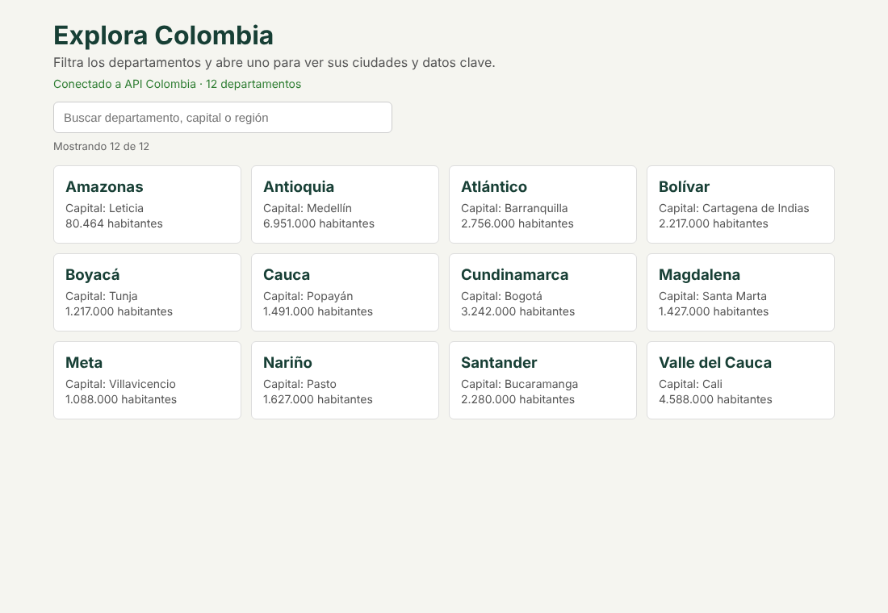
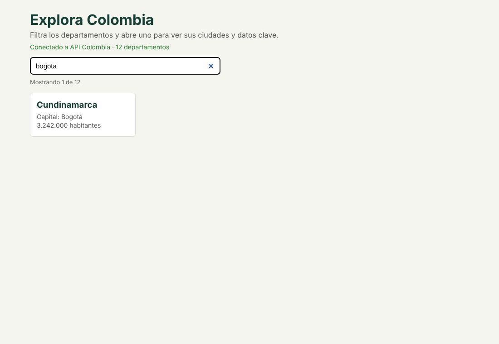
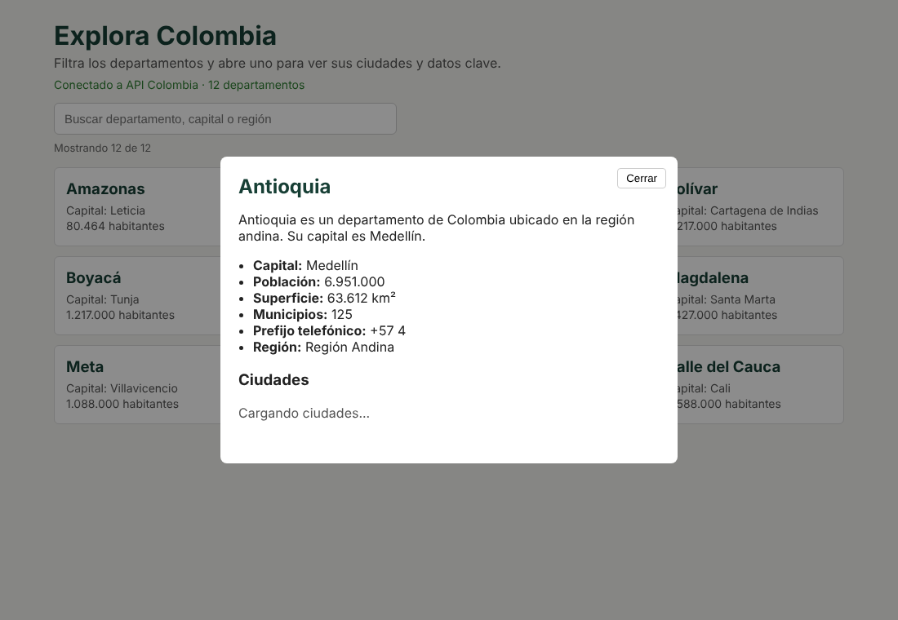
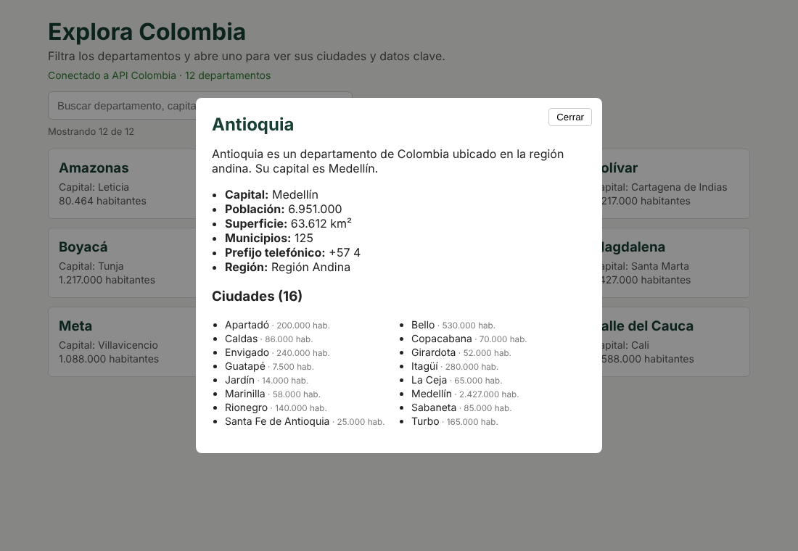

# Explora Colombiaaa
Aplicación de una sola vista hecha con React + Vite + TypeScript que consume la API pública [API Colombia](https://api-colombia.com/api/v1). Permite filtrar los departamentos en tiempo real y abrir un modal con el detalle completo (datos clave y ciudades).

## Instalación y ejecución local

```bash
npm install
npm run dev
```

Después abrir la dirección que muestra la terminal (normalmente http://localhost:5173).

## Cómo comprobar que está conectada a la API

- Bajo el título aparece "Conectado a API Colombia · 32 departamentos" en verde. Si falla, aparece "Sin conexión con la API" en rojo y un botón Reintentar.
- En el navegador: F12, pestaña Network, filtro Fetch/XHR. Debe verse la petición `Department` a `api-colombia.com` con estado 200.
- La API directa: https://api-colombia.com/api/v1/Department

## Endpoints usados

URL base: `https://api-colombia.com` (variable `VITE_API_URL` en `.env`).

- `GET /api/v1/Department` lista de departamentos.
- `GET /api/v1/Department/{id}` datos clave de un departamento.
- `GET /api/v1/Department/{id}/cities` ciudades de un departamento.

## Estructura

```
src/
  App.tsx                      vista única: búsqueda, lista y modal
  config.ts                    textos de la página y URL de la API
  App.css, index.css           estilos (colores en index.css)
  main.tsx
  assets/                      capturas de pantalla
  components/
    SearchBar.tsx
    DepartmentCard.tsx
    DepartmentModal.tsx
  hooks/
    useDepartments.ts          carga la lista (loading, error, reintentar)
    useDepartmentDetail.ts     carga detalle y ciudades del modal
  lib/api.ts                   peticiones a la API y errores HTTP
  types/colombia.ts
```

## Decisiones técnicas

- **Una sola vista, sin router.** El modal se abre guardando el departamento elegido en un `useState` de `App.tsx`.
- **Hooks.** `useState` para búsqueda, selección, carga y errores. `useEffect` para pedir los datos y para cerrar el modal con Escape. `useMemo` para calcular la lista filtrada solo cuando cambian los datos o el texto.
- **Hooks propios.** La lógica de las peticiones está en `useDepartments` y `useDepartmentDetail`, así los componentes solo se encargan de mostrar la información.
- **Filtro en tiempo real.** La lista se pide una sola vez y se filtra en el cliente mientras se escribe. Ignora tildes y mayúsculas y busca por departamento, capital y región.
- **Asincronía y errores HTTP.** `lib/api.ts` usa `fetch` con `async/await`. Si la respuesta no es 2xx lanza un `ApiError` con el código (404, 429, 5xx) y un mensaje claro; si no hay internet muestra un mensaje de conexión.
- **Loading y errores en la interfaz.** Tanto la lista como el modal muestran un texto de carga, el mensaje de error y un botón Reintentar.
- **Respuestas viejas.** Cada efecto usa una bandera `ignore` para no guardar una respuesta si el componente ya cambió o se cerró.
- **Modal.** Se abre con los datos que ya trae la lista y pide el detalle y las ciudades a la vez con `Promise.all`. Se cierra con el botón, haciendo clic afuera o con Escape.

## Capturas

Listado de departamentos:



Filtro en tiempo real (se escribió "bogota"):



Modal cargando las ciudades:



Modal con el detalle completo:



